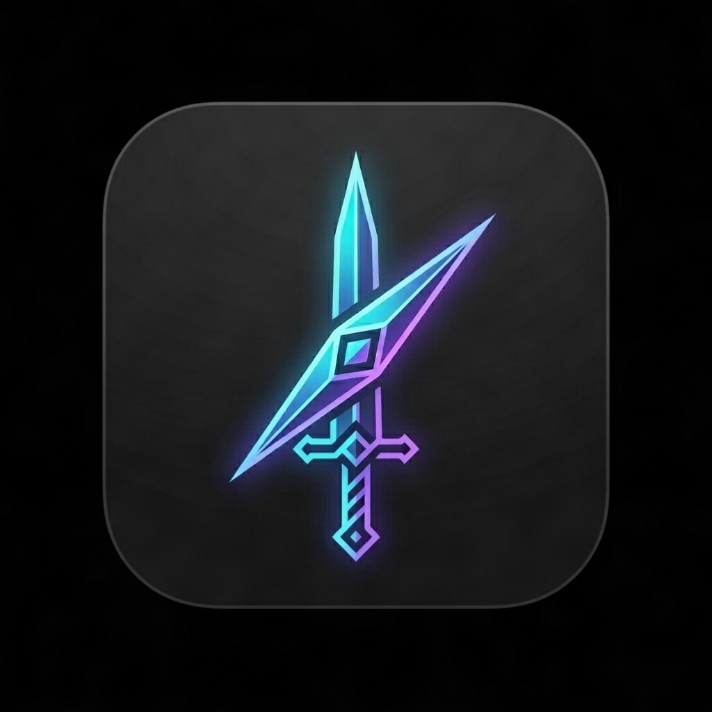

<div align="center">



# ⚔️ Quest Planner

<p align="center">
  <strong>A modern, developer-focused visual workspace combining interactive To-Do sprint lists, whiteboard sticky notes, freehand pen sketching with a custom color palette, and resizable, rotatable image boards.</strong>
</p>
<p align="center">
  Features enterprise-grade <strong>JWT Authentication</strong>, <strong>Role-Based Access Control (RBAC)</strong>, <strong>User Data Isolation</strong>, and an <strong>Admin Oversight Dashboard with Strict Privacy Guards</strong>.
</p>

---

<!-- Badges & Tech Stack Logos -->
<p align="center">
  
  
  
  
  
  
  
  
  
</p>

</div>

---

## 📑 Table of Contents

- [Overview](#-overview)
- [System Architecture](#-system-architecture)
- [Key Features](#-key-features)
- [Security & Privacy Architecture](#-security--privacy-architecture)
  - [Roles & Privileges](#roles-and-privileges)
  - [Database-Enforced Admin Provisioning](#database-enforced-admin-provisioning)
  - [Strict Privacy Guard](#strict-privacy-guard)
- [Monorepo Structure](#-monorepo-structure)
- [Quick Start Guide](#-quick-start-guide)
  - [Prerequisites](#prerequisites)
  - [1. Backend Setup](#1-backend-setup)
  - [2. Frontend Setup](#2-frontend-setup)
- [API Overview](#-api-overview)
- [Deployment Guide (Render & Vercel)](#-deployment-guide-render--vercel)
- [Subproject Documentation](#-subproject-documentation)
- [Contributing & License](#-contributing--license)

---

## 🔍 Overview

**Quest Planner** bridges the gap between daily execution, sprint tracking, and visual creative ideation. Instead of juggling separate apps for checklists, brainstorms, and sketches, Quest Planner unites them on one infinite canvas:

- **Checklists & Task Tracking**: Interactive To-Do nodes with live completion progress bars and individual card deletion.
- **Freehand Pen & Sketching Tool**: Smooth vector drawing layer with custom color palettes (8 presets + custom color picker), stroke widths, undo, and canvas clear.
- **Images (Paste, Reposition, Resize, Rotate)**:
  - Paste images directly from the clipboard (<kbd>Ctrl+V</kbd> / <kbd>Cmd+V</kbd>) or upload from disk.
  - Freely reposition via native dragging.
  - Resize in any direction using `<NodeResizer>` corner & border handles.
  - Rotate arbitrarily (`0° - 360°`) with an interactive top handle knob, step buttons, or a smooth continuous rotation slider (isolated with `nodrag`/`nopan`).
- **Freeform Brainstorming**: Sticky notes featuring 5 color palettes with auto-expanding text fields.
- **Zero-Friction Autosave**: Debounced background persistence storing canvas zoom, positions, nodes, edges, and vector drawings directly into native PostgreSQL `jsonb`.
- **User Privacy & Data Isolation**: Every board is private to its creator; admins can monitor platform stats without any access to private board contents.

---

## 🏗️ System Architecture

```
┌────────────────────────────────────────────────────────────────────────┐
│                        Frontend (Client Layer)                         │
│             React 18 + TypeScript + Vite + Tailwind CSS                │
│                 Infinite Canvas: @xyflow/react (v12)                   │
│          AuthContext (JWT in localStorage) + Axios Interceptors        │
│          Freehand Pen Vector Layer + Resizable/Rotatable Image Nodes   │
└───────────────────────────────────┬────────────────────────────────────┘
                                    │ HTTP / REST + Authorization: Bearer <token>
                                    ▼
┌────────────────────────────────────────────────────────────────────────┐
│                        Backend (Security Layer)                        │
│          Spring Security 6 + JwtAuthenticationFilter (JJWT 0.12)       │
│      BCrypt Password Encoder + Stateless Session Management            │
├────────────────────────────────────────────────────────────────────────┤
│                        Backend (Service Layer)                         │
│                    Spring Boot 3.3.5 (Java 21 LTS)                     │
│    Controllers ──► DTOs ──► User / Board / Admin Services              │
├────────────────────────────────────────────────────────────────────────┤
│                      Persistence & Data Access                         │
│             Spring Data JPA + Hibernate 6 Native JSONB                 │
└───────────────────────────────────┬────────────────────────────────────┘
                                    │ JDBC / HikariCP Pool
                                    ▼
┌────────────────────────────────────────────────────────────────────────┐
│                         PostgreSQL Database                            │
│           Local Instance (localhost:5432) or Serverless Neon           │
│           `users` table (BCrypt credentials & roles)                   │
│           `boards` table with native JSONB `canvas_data` & `user_id`   │
└────────────────────────────────────────────────────────────────────────┘
```

---

## ✨ Key Features

| Domain | Feature | Description |
|---|---|---|
| **Security** | **JWT Authentication** | Secure user registration and login with stateless JWTs (HMAC-SHA256) and BCrypt passwords. |
| **Security** | **Role-Based Access (RBAC)** | Dedicated privileges for `ROLE_USER` and `ROLE_ADMIN`. |
| **Security** | **DB-Only Admin Provisioning** | Account registration window only creates standard users. Admin privileges can only be granted directly via database update. |
| **Privacy** | **Zero-Knowledge Board Isolation** | Users can view/modify only their own boards. Admins cannot view, read, or inspect user boards. |
| **Admin** | **Oversight Dashboard** | Platform statistics and registered user list with aggregate plan counts without leaking user data. |
| **Canvas** | **Infinite Workspace** | Pan, zoom, and multi-touch support powered by `@xyflow/react`. |
| **Drawing** | **Freehand Pen & Palette** | Draw or write freely on the infinite canvas. Includes 8 color presets, custom color picker, stroke width controls, and undo. |
| **Images** | **Paste, Resize & Rotate** | Paste images with `Ctrl+V` or upload files. Drag to reposition, use edge handles to resize, and rotate `0°-360°` using the visual rotation knob or smooth slider. |
| **Canvas** | **Card & Node Deletion** | In-place delete buttons on To-Do cards, Image nodes, and Sticky Notes with cascading edge removal. |
| **Canvas** | **Docked Toolbar** | Quick-add controls for To-Do Lists, Sticky Notes, Image Upload, and Pen Drawing with responsive collapse. |
| **Data** | **PostgreSQL JSONB** | Stores node graphs, edges, drawings, and viewport positions inside a native `jsonb` column. |
| **Branding** | **Custom Emblem Icon** | Custom neon sword & compass logo integrated as favicon, touch icon, and header emblem. |
| **Theme** | **Class-based Dark Mode** | Persistent theme toggle synchronized with `localStorage` and OS preference. |
| **Sync** | **Debounced Autosave** | Automatically updates the backend 1.5s after user movement, drawing, or text input. |

---

## 🛡️ Security & Privacy Architecture

### Roles and Privileges

* **`ROLE_USER`**:
  * Default role for all accounts registered through the application.
  * Create, edit, autosave, view, and delete **strictly their own** boards.
  * Attempting to query another user's board ID yields a clean `404 Not Found`.

* **`ROLE_ADMIN`**:
  * Access the **Admin Oversight Dashboard** (`GET /api/v1/admin/users`).
  * Inspect registered user metadata (User ID, Username, Email, Joined Date) and **Total Plans Created** (`planCount`).
  * **Strict Privacy Guard**: Admins are programmatically prohibited from inspecting, reading, or opening any user's board titles, sticky notes, task lists, sketches, or images.

### Database-Enforced Admin Provisioning

To prevent unauthorized privilege escalation, the account registration window contains **no admin selection option**. Every user registering via the API or frontend is strictly assigned `ROLE_USER`.

To grant administrator access to an account, execute this query directly in PostgreSQL:

```sql
UPDATE users
SET role = 'ROLE_ADMIN'
WHERE username = '<target-username>';
```

---

## 📂 Monorepo Structure

```
Planner/
├── 📄 README.md                 # 🌟 Master project documentation (you are here)
├── 📄 logo.png                  # Quest Planner neon sword & compass logo
├── 📄 .gitignore                # Global gitignore covering Java, Maven, Node, and IDEs
│
├── 📁 backend/                  # ☕ Spring Boot REST API
│   ├── pom.xml                  # Maven dependencies & build configuration (Java 21, Security, JJWT)
│   ├── Dockerfile               # Multi-stage production build (Maven + Alpine JRE 21)
│   ├── .env.example             # Template for database & JWT environment variables
│   ├── README.md                # 📖 Detailed Backend architecture & setup guide
│   └── src/
│       ├── main/java/com/whiteboard/backend/
│       │   ├── BackendApplication.java
│       │   ├── config/          # SecurityConfig, CorsConfig
│       │   ├── controller/      # AuthController, BoardController, AdminController
│       │   ├── dto/             # Request & Response DTOs (Auth, Board, Admin)
│       │   ├── entity/          # JPA User & Board entities (with JSONB mapping)
│       │   ├── exception/       # GlobalExceptionHandler (400, 401, 403, 404, 500)
│       │   ├── repository/      # UserRepository, BoardRepository
│       │   ├── security/        # JwtTokenProvider, JwtAuthenticationFilter, CustomUserDetails
│       │   └── service/         # AuthService, BoardService, AdminService
│       └── main/resources/
│           └── application.yml  # Safe environment variable configuration (no hardcoded secrets)
│
└── 📁 frontend/                 # ⚛️ React 18 + Vite Web Application
    ├── public/
    │   ├── favicon.png          # Browser favicon
    │   └── logo.png             # Quest Planner site icon
    ├── package.json             # NPM dependencies & scripts (@xyflow/react, axios, lucide)
    ├── README.md                # 📖 Detailed Frontend UI/UX guide
    ├── vercel.json              # SPA routing rewrites for Vercel
    ├── vite.config.ts           # Vite server & API proxy config
    ├── tailwind.config.js       # Tailwind CSS with class-based dark mode
    └── src/
        ├── App.tsx              # Application root, client-side router & protected routes
        ├── main.tsx             # DOM mount & stylesheet initialization
        ├── index.css            # Custom design tokens, scroll containment & React Flow CSS
        ├── types/               # TypeScript definitions (User, Auth, Canvas, Drawing, Image, Board)
        ├── services/            # Axios API client with JWT Bearer token interceptor
        ├── context/             # AuthContext (JWT session) & ThemeContext (dark/light)
        └── components/
            ├── auth/            # LoginPage & RegisterPage
            ├── admin/           # AdminDashboardPage (privacy-guarded user metrics)
            ├── dashboard/       # Dashboard view & board creation modal
            └── canvas/          # CanvasPage, docked toolbar, freehand pen layer
                └── nodes/
                    ├── TodoNode.tsx       # Checklist node with delete button
                    ├── StickyNoteNode.tsx # Sticky note node with delete button
                    └── ImageNode.tsx      # Resizable, rotatable image card
```

---

## 🚀 Quick Start Guide

### Prerequisites
* ☕ **Java 21 LTS** (Amazon Corretto, Eclipse Temurin, or Oracle JDK)
* 🐘 **PostgreSQL 14+** (Local native service or [Neon Serverless Postgres](https://neon.tech))
* 🟢 **Node.js 18+** & **npm**

---

### 1. Backend Setup

1. **Create the PostgreSQL Database**:
   ```sql
   CREATE DATABASE whiteboard_db;
   ```

2. **Configure Environment Variables**:
   Copy [`backend/.env.example`](backend/.env.example) to `backend/.env` or set environment variables:
   ```bash
   SPRING_DATASOURCE_URL=jdbc:postgresql://localhost:5432/whiteboard_db
   SPRING_DATASOURCE_USERNAME=postgres
   SPRING_DATASOURCE_PASSWORD=postgres
   JWT_SECRET=404E635266556A586E3272357538782F413F4428472B4B6250645367566B5970
   ```

3. **Build & Run the Backend**:
   ```bash
   cd backend
   mvn clean spring-boot:run
   ```
   *The REST API will start on **http://localhost:8080**.*

---

### 2. Frontend Setup

1. **Install Dependencies**:
   ```bash
   cd frontend
   npm install
   ```

2. **Start the Development Server**:
   ```bash
   npm run dev
   ```
   *The frontend will launch at **http://localhost:5173** and automatically proxy API calls to port 8080.*

---

## 📡 API Overview

### Authentication (`/api/v1/auth`)
| Method | Endpoint | Request Body | Description | Access |
|---|---|---|---|---|
| `POST` | `/api/v1/auth/register` | `RegisterRequest` | Register a new standard user (`ROLE_USER`) | Public |
| `POST` | `/api/v1/auth/login` | `LoginRequest` | Authenticate and obtain JWT token | Public |
| `GET` | `/api/health` | — | Service health check | Public |

### Admin Oversight (`/api/v1/admin`)
| Method | Endpoint | Description | Access |
|---|---|---|---|
| `GET` | `/api/v1/admin/users` | List registered users with total plan counts (Strict Privacy Guard) | `ROLE_ADMIN` |

### Board Workspace (`/api/v1/boards`)
| Method | Endpoint | Request Body | Description | Access |
|---|---|---|---|---|
| `GET` | `/api/v1/boards` | — | Fetch summaries of boards owned by authenticated user | Authenticated |
| `GET` | `/api/v1/boards/{id}` | — | Fetch full board details & canvas JSON (ownership verified) | Authenticated |
| `POST` | `/api/v1/boards` | `CreateBoardRequest` | Create a new board owned by authenticated user | Authenticated |
| `PUT` | `/api/v1/boards/{id}` | `UpdateBoardRequest` | Update title, description, or autosave canvas nodes, edges & drawings | Authenticated |
| `DELETE`| `/api/v1/boards/{id}` | — | Permanently delete a user's board | Authenticated |
| `DELETE`| `/api/v1/boards/{id}/nodes/{nodeId}` | — | Delete a single node and cascade-remove connected edges | Authenticated |

---

## ☁️ Deployment Guide (Render & Vercel)

### 1. Backend on Render (Web Service / Docker)
* **Root Directory**: `backend`
* **Environment**: `Docker` (or Native Java with `mvn clean package -DskipTests`)
* **Dockerfile Path**: `Dockerfile`
* **Environment Variables** (in Render Dashboard):
  * `SPRING_DATASOURCE_URL`: `jdbc:postgresql://<neon-host>/<db-name>?sslmode=require`
  * `SPRING_DATASOURCE_USERNAME`: `<db-user>`
  * `SPRING_DATASOURCE_PASSWORD`: `<db-password>`
  * `JWT_SECRET`: `<secure-random-256bit-string>`
  * `CORS_ALLOWED_ORIGIN_PATTERNS`: `https://*.vercel.app`

### 2. Frontend on Vercel
* **Root Directory**: `frontend`
* **Framework Preset**: `Vite`
* **Build Command**: `npm run build`
* **Output Directory**: `dist`
* **Environment Variables** (in Vercel Dashboard):
  * `VITE_API_BASE_URL`: `https://<your-render-backend-url>.onrender.com/api/v1/boards`

---

## 📖 Subproject Documentation

For deep-dive documentation on each respective module, check out their dedicated guides:

| Module | Documentation Link | Highlights |
|---|---|---|
| ☕ **Backend** | [**backend/README.md**](backend/README.md) | SecurityConfig, JJWT token provider, JPA entities, DB-only admin provisioning, and JSONB canvas storage. |
| ⚛️ **Frontend** | [**frontend/README.md**](frontend/README.md) | React Flow canvas nodes, Pen sketching tool, Resizable & rotatable Image nodes with drag/slider controls, Custom logo & favicon, AuthContext, and dark mode tokens. |

---

## 🤝 Contributing & License

This project is licensed under the **MIT License**.
